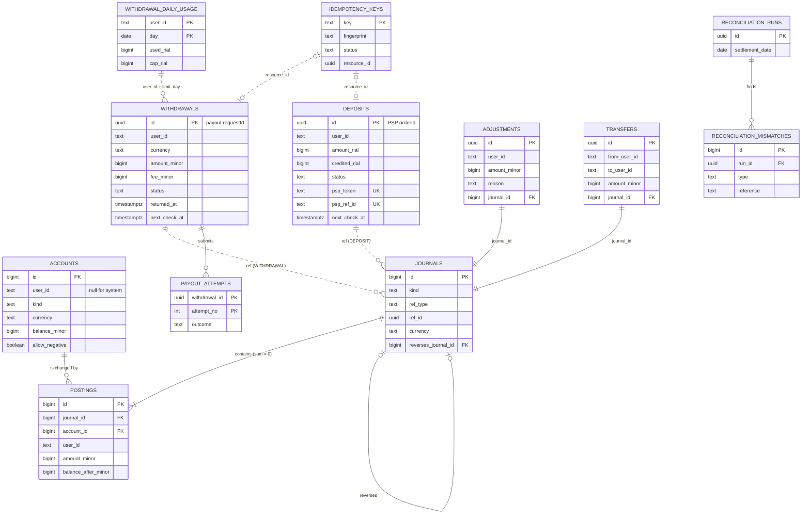

# Data model

PostgreSQL 17 is the only source of truth. This file specifies every table: columns, types, keys, constraints and indexes. Migrations implement exactly this..

## Conventions

| Rule | Why |
|---|---|
| Table names plural and snake_case; every table has `created_at timestamptz NOT NULL DEFAULT now()` | One vocabulary, sortable audit |
| Money is `bigint` in **minor units**. A column ending `_rial` is always rial. A column ending `_minor` sits next to a `currency` column (`IRR` = rial, `USDT` = 10⁻⁶ USDT) | No floats; the unit is in the name (ADR-4) |
| Internal currency codes are `IRR` and `USDT`. The API's `IRT` (toman) is converted ×10 at the edge | Matches both providers (PSP-01, PAY-01) |
| Statuses and kinds are `text` with a `CHECK (… IN (…))`, never PostgreSQL enum types | A CHECK changes in one migration; enum values can't be removed |
| Append-heavy tables (postings, journals, outbox, events) use `bigint GENERATED ALWAYS AS IDENTITY` keys | Sequential inserts, small indexes |
| Ids that leave the system (`depositId`, `withdrawalId`, adjustment and transfer ids) are UUIDv7, generated by the application | Exists before insert (it doubles as PSP `orderId` / payout `requestId`); time-ordered for index locality |
| `user_id` is `text` matching `^[A-Za-z0-9_-]{1,64}$` | A3; there is no users table, wallets are created on first use |
| Business dates come from the database clock: `(now() AT TIME ZONE 'Asia/Tehran')::date` | Instances can't disagree about "today" (ADR-12) |
| Mutable tables get an `updated_at` trigger; ledger tables are immutable | Audit trail |

## Diagram

Not drawn, because nothing references them: `outbox`, `inbox`, `notifications`, `inbound_events`, `state_transitions`.

## Ledger tables (owned by the ledger module)

### `accounts`
One row per bucket of money. A user gets three per currency on first use; system accounts are seeded by the first migration.

| Column | Type | Null | Notes |
|---|---|---|---|
| id | bigint identity | no | PK |
| owner_type | text | no | `USER` \| `SYSTEM` |
| user_id | text | yes | set iff `owner_type = 'USER'` |
| kind | text | no | user: `AVAILABLE`, `FROZEN`, `DEBT` · system: `PSP_CLEARING`, `PAYOUT_CLEARING`, `FEE_REVENUE`, `OPS_ADJUSTMENTS` |
| currency | text | no | `IRR` \| `USDT` |
| balance_minor | bigint | no | default 0; sum of this account's postings |
| allow_negative | boolean | no | true for every system account and for `DEBT` |
| created_at, updated_at | timestamptz | no | |

- `UNIQUE NULLS NOT DISTINCT (user_id, kind, currency)`: one of each per user, one of each system account.
- `CHECK (allow_negative OR balance_minor >= 0)`: the last line of defence against overdraft.
- `CHECK ((owner_type = 'USER') = (user_id IS NOT NULL))`, plus a CHECK pairing user kinds with `USER` and system kinds with `SYSTEM`.
- `CHECK (kind <> 'DEBT' OR balance_minor <= 0)`: debt is zero or negative.
- Storage: `fillfactor = 90`, so balance updates stay in-page.
- Seed: every system kind × both currencies (8 rows).

**Sign convention.** A positive balance means the bucket holds money. System accounts mirror the outside world and go negative as money enters through them; `PSP_CLEARING` at −50,000,000 means 50,000,000 rial came in through the gateway.

### `journals`
One row per business event that moves money. Immutable.

| Column | Type | Null | Notes |
|---|---|---|---|
| id | bigint identity | no | PK |
| kind | text | no | see the kinds table below |
| ref_type | text | no | `DEPOSIT` \| `WITHDRAWAL` \| `ADJUSTMENT` \| `TRANSFER` |
| ref_id | uuid | no | the business record |
| currency | text | no | every posting must match |
| reverses_journal_id | bigint | yes | FK `journals(id)`; for manual corrections |
| description | text | yes | human text, e.g. "Return of withdrawal 0193…" |
| created_at | timestamptz | no | |

- `UNIQUE (kind, ref_type, ref_id)`: the same event can never be booked twice.
- `UNIQUE (ref_id) WHERE kind IN ('WITHDRAWAL_SETTLE', 'WITHDRAWAL_RELEASE')`: a withdrawal is settled **or** released, never both.
- Deferred constraint trigger: at commit, every journal has at least two postings.
- Trigger rejects `UPDATE` and `DELETE`.

| kind | ref | Postings |
|---|---|---|
| `DEPOSIT_CREDIT` | deposit | PSP_CLEARING −x · DEBT +min(debt, x) · AVAILABLE +rest |
| `ADJUSTMENT_CREDIT` | adjustment | OPS_ADJUSTMENTS −x · DEBT +min(debt, x) · AVAILABLE +rest |
| `WITHDRAWAL_FREEZE` | withdrawal | AVAILABLE −(x + fee) · FROZEN +(x + fee) |
| `WITHDRAWAL_SETTLE` | withdrawal | FROZEN −(x + fee) · PAYOUT_CLEARING +x · FEE_REVENUE +fee |
| `WITHDRAWAL_RELEASE` | withdrawal | FROZEN −(x + fee) · AVAILABLE +(x + fee) |
| `WITHDRAWAL_RETURN` | withdrawal | PAYOUT_CLEARING −x · DEBT +min(debt, x) · AVAILABLE +rest (the fee is kept: the payout happened; incoming money pays debt first) |
| `WITHDRAWAL_LATE_SUCCESS` | withdrawal | PAYOUT_CLEARING +x · AVAILABLE −min(available, x) · DEBT −rest |
| `TRANSFER` (bonus) | transfer | A.AVAILABLE −x · B.DEBT +min · B.AVAILABLE +rest |

Every credit to a user goes through one rule: **incoming money pays off debt first**. So `AVAILABLE > 0` implies `DEBT = 0`, and a user in debt can never withdraw (ADR-10).

### `postings`
One row per account change. Immutable.

| Column | Type | Null | Notes |
|---|---|---|---|
| id | bigint identity | no | PK; also the history cursor |
| journal_id | bigint | no | FK `journals` |
| account_id | bigint | no | FK `accounts` |
| user_id | text | yes | copied from the account, for history |
| account_kind | text | no | copied, so history needs no account join |
| currency | text | no | must equal the account's and the journal's |
| amount_minor | bigint | no | signed; `CHECK (amount_minor <> 0)` |
| balance_after_minor | bigint | no | the account balance right after this posting |
| created_at | timestamptz | no | |

- `INDEX (user_id, id DESC) WHERE user_id IS NOT NULL`: wallet history (keyset).
- `INDEX (account_id, id DESC)`: per-account audit and invariant checks.
- `INDEX (journal_id)`.
- Deferred constraint trigger: at commit, the postings of each journal sum to 0 and share one currency.
- Trigger rejects `UPDATE` and `DELETE`.

## Withdrawal tables (owned by the withdrawal module)

### `withdrawals`

| Column | Type | Null | Notes |
|---|---|---|---|
| id | uuid | no | PK; **also the payout `requestId`**, never regenerated |
| user_id | text | no | |
| currency | text | no | `IRR` \| `USDT` |
| amount_minor | bigint | no | `> 0`; what the destination receives |
| fee_minor | bigint | no | `>= 0`; 0 for IRR, 1 USDT for USDT |
| destination_type | text | no | `IBAN` \| `TRC20` |
| destination | text | no | normalised (IBAN upper case, no spaces) |
| status | text | no | `PENDING`, `SUBMITTING`, `PROCESSING`, `SUCCEEDED`, `FAILED` |
| failure_reason | text | yes | required iff `FAILED`: `PROVIDER_REJECTED`, `PROVIDER_FAILED`, `CANCELLED` |
| provider_status | text | yes | last status read from the provider |
| provider_reason | text | yes | e.g. `INVALID_IBAN`, `ACCOUNT_CLOSED` |
| provider_tracking_id | text | yes | `trackingId` |
| limit_day | date | no | Tehran day the amount counts against |
| limit_amount_rial | bigint | no | amount counted toward the daily limit |
| limit_rate_rial_per_usdt | bigint | yes | USDT only (bonus): the reference rate used, rial per 1 USDT (`USDT_IRT_REFERENCE_RATE` toman × 10), snapshotted at request; `limit_amount_rial` is the amount × this rate, rounded up |
| submit_attempts | int | no | default 0 |
| needs_review | boolean | no | default false |
| review_reason | text | yes | `STUCK`, `REPLAY_MISMATCH`, `LATE_SUCCESS`, `UNKNOWN_AFTER_SUCCESS` |
| returned_at | timestamptz | yes | set when the bank returns a paid transfer |
| return_reason | text | yes | provider reason, e.g. `ACCOUNT_CLOSED` |
| late_success_at | timestamptz | yes | Ambiguity #1 correction time |
| next_check_at | timestamptz | yes | when the sweeper should look again; null = nothing to do |
| submitted_at, completed_at | timestamptz | yes | `completed_at` set iff status is final |
| created_at, updated_at | timestamptz | no | |

- `CHECK ((failure_reason IS NOT NULL) = (status = 'FAILED'))`
- `CHECK ((completed_at IS NOT NULL) = (status IN ('SUCCEEDED', 'FAILED')))`
- `CHECK (returned_at IS NULL OR status = 'SUCCEEDED')`
- `CHECK (destination_type = CASE currency WHEN 'IRR' THEN 'IBAN' ELSE 'TRC20' END)`, and a format CHECK on `destination` (`IR` + 24 digits, or `T` + 33 base58 characters) behind the app's mod-97 and base58check validation
- `return_reason` only with `returned_at`; `late_success_at` only when `SUCCEEDED`; `needs_review` needs a `review_reason`; `limit_rate_rial_per_usdt` only on USDT; CHECKs on every status and reason list
- `INDEX (next_check_at) WHERE next_check_at IS NOT NULL`: the sweeper's queue, which includes successful withdrawals still watched for returns.
- `INDEX (user_id, created_at DESC)`
- `INDEX (created_at) WHERE needs_review`: the review queue.

### `payout_attempts`
Every submit to the payout service, opened **before** the call.

| Column | Type | Null | Notes |
|---|---|---|---|
| withdrawal_id | uuid | no | PK part; FK `withdrawals` |
| attempt_no | int | no | PK part; 1, 2, … |
| request_body | jsonb | no | exactly what was sent |
| started_at | timestamptz | no | |
| finished_at | timestamptz | yes | null = in flight, or the process died mid-call |
| outcome | text | yes | `ACCEPTED`, `REPLAYED`, `REJECTED`, `AMBIGUOUS`, `MISMATCH` |
| http_status | int | yes | |
| error | text | yes | timeout / reset / message |
| response_body | jsonb | yes | raw response |

### `withdrawal_daily_usage`

| Column | Type | Null | Notes |
|---|---|---|---|
| user_id | text | no | PK part |
| day | date | no | PK part; Tehran calendar day |
| used_rial | bigint | no | default 0 |
| cap_rial | bigint | no | copied from config when the row is created (2,000,000,000) |
| updated_at | timestamptz | no | |

- `CHECK (used_rial >= 0 AND used_rial <= cap_rial)`: even a buggy code path can't exceed the limit.

## Deposit table (owned by the deposit module)

### `deposits`

| Column | Type | Null | Notes |
|---|---|---|---|
| id | uuid | no | PK; **also the PSP `orderId`** |
| user_id | text | no | |
| amount_rial | bigint | no | requested; `> 0` |
| credited_rial | bigint | yes | the verified amount actually credited |
| status | text | no | `CREATED`, `PENDING`, `SUCCEEDED`, `FAILED` |
| failure_reason | text | yes | required iff `FAILED`: `PSP_REJECTED`, `PSP_FAILED`, `PSP_REVERSED`, `EXPIRED`, `CREATE_ABANDONED` |
| psp_token | text | yes | unique |
| payment_url | text | yes | |
| psp_status | text | yes | last status read: `INIT`, `PAID`, `VERIFIED`, `FAILED`, `REVERSED` |
| psp_ref_id | text | yes | unique; the bank reference, used by reconciliation |
| paid_seen_at | timestamptz | yes | first time we saw PAID; drives the 2-minute alert |
| needs_review | boolean | no | default false |
| review_reason | text | yes | `AMOUNT_DIFFERS`, `UNVERIFIED_TOO_LONG`, `LATE_PAYMENT_AFTER_EXPIRY`, `UNKNOWN_TOKEN`, `DUPLICATE_REF` |
| next_check_at | timestamptz | yes | null = nothing to do |
| check_attempts | int | no | default 0; drives the poll schedule |
| expires_at | timestamptz | no | `created_at + 24 h` (ADR-11) |
| completed_at | timestamptz | yes | set iff final |
| created_at, updated_at | timestamptz | no | |

- `UNIQUE (psp_token)`, `UNIQUE (psp_ref_id)`: one gateway payment can credit at most one deposit.
- `CHECK ((failure_reason IS NOT NULL) = (status = 'FAILED'))`
- `CHECK ((credited_rial IS NOT NULL) = (status = 'SUCCEEDED'))`
- `INDEX (next_check_at) WHERE next_check_at IS NOT NULL`
- `INDEX (user_id, created_at DESC)`

## Operations tables

### `adjustments`

| Column | Type | Null | Notes |
|---|---|---|---|
| id | uuid | no | PK |
| user_id | text | no | |
| currency | text | no | |
| amount_minor | bigint | no | `> 0`; increases only |
| reason | text | no | `CHECK (char_length(reason) BETWEEN 3 AND 500)` |
| actor | text | yes | from `X-Operator-Id`; 1–128 characters |
| journal_id | bigint | no | unique FK `journals` |
| created_at | timestamptz | no | |

- `CHECK` on `user_id` format and currency; `INDEX (user_id, created_at DESC)`.

### `reconciliation_runs` and `reconciliation_mismatches`

| Table | Columns |
|---|---|
| `reconciliation_runs` | id uuid PK · settlement_date date (a Tehran day) · started_at · finished_at (`>= started_at`) · settlement_rows int (every data row of the file, unreadable ones too) · matched int (references present on both sides for the same amount) · mismatch_count int · raw_csv text (the exact file; NUL becomes U+FFFD) · `INDEX (settlement_date, started_at DESC)` |
| `reconciliation_mismatches` | id bigint PK · run_id FK · type (`MISSING_IN_LEDGER`, `MISSING_IN_SETTLEMENT`, `AMOUNT_MISMATCH`, `DUPLICATE_IN_SETTLEMENT`, `UNREADABLE_ROW`) · reference (bank refId without padding; null for an unreadable row) · deposit_id uuid null (no foreign key) · our_amount_rial · their_amount_rial (both `> 0` when set) · details jsonb. A `CHECK` gives each type the fields it needs: `AMOUNT_MISMATCH` has both amounts and they differ, `MISSING_IN_LEDGER` only theirs, `MISSING_IN_SETTLEMENT` only ours and a deposit id. `INDEX (run_id, id)`. Rows are only inserted, never updated |

Two indexes on `deposits` serve a run: `deposits_credited_at_idx (completed_at) WHERE status = 'SUCCEEDED'` (credited that day) and `deposits_ref_normalized_idx ((ltrim(psp_ref_id, '0')))` (the PSP file pads references to 13 digits).

## Transfer table

### `transfers`
id uuid PK · from_user_id · to_user_id · currency `IRR` \| `USDT` · amount_minor `> 0` · journal_id bigint FK → journals, `UNIQUE` · created_at · `CHECK (from_user_id <> to_user_id)` and valid user ids (`^[A-Za-z0-9_-]{1,64}$`). `INDEX (from_user_id, created_at DESC)` and `(to_user_id, created_at DESC)`.

## Cross-cutting tables

### `idempotency_keys` (owned by the idempotency module)

| Column | Type | Null | Notes |
|---|---|---|---|
| key | text | no | PK; 1–255 printable ASCII characters (`CHECK`); global scope |
| scope | text | no | `POST /withdrawals`, `POST /deposits`, … |
| fingerprint | text | no | sha256 of scope + canonical JSON body |
| status | text | no | `IN_PROGRESS` \| `COMPLETED` |
| response_status | int | yes | required when `COMPLETED` |
| response_body | json | yes | required when `COMPLETED`; `json`, not `jsonb`, so a replay is byte for byte the original (`jsonb` reorders keys) |
| resource_type, resource_id | text, uuid | yes | the record the request created |
| locked_until | timestamptz | yes | lease, used only by the two-phase deposit create |
| created_at, completed_at | timestamptz | | |

- `CHECK (status <> 'COMPLETED' OR (response_status IS NOT NULL AND response_body IS NOT NULL))`
- `CHECK ((completed_at IS NOT NULL) = (status = 'COMPLETED'))`, `CHECK ((resource_type IS NULL) = (resource_id IS NULL))`
- `INDEX (created_at)` for the 7-day cleanup.

### `outbox` (owned by the messaging module)

| Column | Type | Null | Notes |
|---|---|---|---|
| id | bigint identity | no | PK; also the message id |
| exchange | text | no | `wallet.jobs` \| `wallet.events` |
| routing_key | text | no | e.g. `job.withdrawal.submit` |
| aggregate_type, aggregate_id | text | no | e.g. `WITHDRAWAL`, the id |
| payload | jsonb | no | ids only, never amounts to act on |
| created_at | timestamptz | no | |
| claimed_until | timestamptz | yes | relay lease |
| published_at | timestamptz | yes | null = not yet sent |
| attempts | int | no | default 0 |
| last_error | text | yes | |

- `INDEX (id) WHERE published_at IS NULL` (the relay's queue) and `INDEX (published_at) WHERE published_at IS NOT NULL` (the purge's). Published rows are deleted after `OUTBOX_RETENTION_DAYS` (3); an unsent row never is.

### `inbox` (owned by messaging)
`(consumer text, message_id text)` PK · processed_at `INDEX (processed_at)`. A consumer inserts its message id in the same transaction as its effect; a duplicate insert means "already applied". Ids are purged after `INBOX_RETENTION_DAYS` (7).

### `notifications` (owned by the notification module)
id bigint identity PK · message_id text `UNIQUE` (the envelope's id, backing the inbox up) · user_id · kind `BALANCE_CHANGED` · currency · journal_id bigint · available_minor, frozen_minor, debt_minor (the balances as read when the message was handled) · created_at. `INDEX (user_id, id DESC)`.

### `inbound_events` (owned by integrations)
Every PSP callback and payout webhook exactly as received, rejected ones included. This is both an audit trail and evidence.

| Column | Type | Null | Notes |
|---|---|---|---|
| id | bigint identity | no | PK |
| source | text | no | `PSP_CALLBACK` \| `PAYOUT_WEBHOOK` |
| event_id | text | yes | payout `x-event-id` |
| reference | text | yes | PSP token or payout requestId |
| signature_valid | boolean | yes | null for PSP (unsigned) |
| headers | jsonb | no | |
| raw_body | text | no | exact bytes as text |
| outcome | text | no | `ACCEPTED`, `REJECTED_SIGNATURE`, `UNKNOWN_REFERENCE`, `MISMATCH`, `IGNORED_FINAL` |
| received_at | timestamptz | no | |

- `INDEX (reference, received_at)`, `INDEX (received_at)`. Retention 30 days.
- `CHECK`: a payout webhook always has `signature_valid`; `REJECTED_SIGNATURE` only with `signature_valid = false`.

### `state_transitions` (shared, append-only)
One row per status change of a deposit or withdrawal, so "what happened to this withdrawal?" is one query.

| Column | Type | Notes |
|---|---|---|
| id | bigint identity | PK |
| entity_type | text | `DEPOSIT` \| `WITHDRAWAL` |
| entity_id | uuid | |
| from_status, to_status | text | `from_status` null on creation; equal values for flag-only events (return, review) |
| event | text | e.g. `PROVIDER_ACCEPTED`, `RETURNED`, `MARKED_FOR_REVIEW` |
| cause | text | `API`, `SUBMIT`, `WEBHOOK`, `CALLBACK`, `POLL`, `SWEEPER`, `OPS` |
| detail | jsonb | provider snapshot, attempt number |
| created_at | timestamptz | |

- `INDEX (entity_id, id)`. Trigger rejects `UPDATE` and `DELETE`.

## Database functions and triggers

| Name | On | Does |
|---|---|---|
| `reject_mutation()` | `BEFORE UPDATE OR DELETE` on journals, postings, state_transitions | Raises: history is append-only |
| `check_journal_balanced()` | `CONSTRAINT TRIGGER AFTER INSERT ON postings DEFERRABLE INITIALLY DEFERRED` | Sum = 0, one currency, matches the journal and the account |
| `check_journal_has_postings()` | `CONSTRAINT TRIGGER AFTER INSERT ON journals DEFERRABLE INITIALLY DEFERRED` | At least two postings exist at commit |
| `touch_updated_at()` | `BEFORE UPDATE` on mutable tables | Sets `updated_at` |

**Roles (cheap defence in depth).** Migrations run as the owner. The app connects as `t103_app`, which has `SELECT, INSERT` only on journals, postings and state_transitions. A bug, or a hand-typed SQL statement through the app, cannot rewrite history.

## Retention

| Table | Kept |
|---|---|
| journals, postings, deposits, withdrawals, payout_attempts, adjustments, transfers, state_transitions | Forever (financial records) |
| idempotency_keys | 7 days (business uniqueness lives in the tables above) |
| outbox (published) | 3 days |
| inbound_events | 30 days |
| withdrawal_daily_usage | 90 days |

## Hot queries and the index each uses

| Query | Index |
|---|---|
| Lock a user's accounts | `accounts` unique (user_id, kind, currency) |
| Wallet history page | `postings (user_id, id DESC)` + `journals` PK |
| Sweeper: due withdrawals / deposits | partial `(next_check_at) WHERE next_check_at IS NOT NULL` |
| Relay: unsent outbox | partial `(id) WHERE published_at IS NULL` |
| Webhook → withdrawal | `withdrawals` PK (requestId = id) |
| Callback → deposit | `deposits` PK (orderId = id) + unique `psp_token` |
| Review queue | partial `(created_at) WHERE needs_review` |
| Reconciliation by bank reference | unique `deposits.psp_ref_id` |
